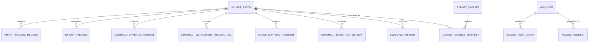

# 📚 DATA DICTIONARY & MIGRATION GUIDE V1 (FINRA FINANCIAL DASHBOARD)

> **Mã kế hoạch**: Plan 01 — CSDL và Lịch sử  
> **Phiên bản Schema**: 001_versioned_schema  
> **Hệ quản trị CSDL**: PostgreSQL 16 Alpine  
> **Nguyên tắc**: Relational Versioned, Lean Schema (Không lưu lãi suất, không lưu 80+ cột JSON), Bất biến Dataset, Hỗ trợ đối soát và rollback.

---

## 1. TỔNG QUAN CÁC BẢNG & ERD NGHIỆP VỤ



---

## 2. CHI TIẾT TỪ ĐIỂN DỮ LIỆU (DATA DICTIONARY)

### 2.1. Bảng `source_batch` (Quản lý đợt nạp file nguồn)
| Tên cột | Kiểu dữ liệu | Nullable | Khóa / Chỉ mục | Diễn giải & Giá trị hợp lệ |
| :--- | :--- | :---: | :---: | :--- |
| `id` | BIGSERIAL | NO | PK | Khóa tự tăng vật lý |
| `source_type` | VARCHAR(50) | NO | INDEX | `APPENDIX`, `SETTLEMENT`, `STOCK`, `EXCEPTION`, `EMPLOYEE` |
| `file_name` | VARCHAR(300) | NO | | Tên file gốc upload |
| `file_sha256` | CHAR(64) | NO | INDEX | Mã băm toàn vẹn file chống upload lặp |
| `source_date` | DATE | YES | | Ngày dữ liệu của báo cáo |
| `effective_date` | DATE | YES | | Ngày bắt đầu áp dụng hiệu lực nghiệp vụ |
| `storage_key` | VARCHAR(500) | YES | | Đường dẫn lưu file snapshot an toàn |
| `mapping_version` | VARCHAR(50) | NO | | Phiên bản parser/mapping (mặc định `'v1'`) |
| `status` | VARCHAR(30) | NO | INDEX | `STAGING`, `VALIDATED`, `PREVIEWED`, `CONFIRMED`, `FAILED` |
| `total_rows` | INT | NO | | Tổng số dòng đọc được từ file |
| `new_rows` | INT | NO | | Số dòng mới |
| `unchanged_rows`| INT | NO | | Số dòng trùng fingerprint không đổi |
| `changed_rows`  | INT | NO | | Số dòng có sửa đổi giá trị |
| `ambiguous_rows`| INT | NO | | Số dòng mơ hồ cần Admin xác định đối tượng |
| `invalid_rows`  | INT | NO | | Số dòng lỗi validation |
| `error_summary` | TEXT | YES | | Tóm tắt lỗi nếu trạng thái FAILED |
| `uploaded_by`   | VARCHAR(100)| NO | | Username người tải lên |
| `uploaded_at`   | TIMESTAMPTZ | NO | | Thời điểm tải lên |
| `confirmed_by`  | VARCHAR(100)| YES| | Username người xác nhận import |
| `confirmed_at`  | TIMESTAMPTZ | YES| | Thời điểm xác nhận import |

---

### 2.2. Bảng `employee_history` (Lịch sử nhân sự & cây tổ chức theo khoảng hiệu lực)
| Tên cột | Kiểu dữ liệu | Nullable | Khóa / Chỉ mục | Diễn giải & Giá trị hợp lệ |
| :--- | :--- | :---: | :---: | :--- |
| `id` | BIGSERIAL | NO | PK | Khóa tự tăng |
| `employee_id` | VARCHAR(50) | NO | INDEX | Mã nhân sự / Sale (text, giữ số 0 đầu) |
| `full_name` | VARCHAR(200) | NO | | Họ và tên nhân sự |
| `position` | VARCHAR(50) | NO | | Chức vụ: `TGĐ`, `PTM`, `GĐCN`, `TPKD`, `CVKD`, `CTV` |
| `source_level` | VARCHAR(50) | YES | | Cấp từ nguồn (Cấp 1, Cấp 2...) |
| `department` | VARCHAR(150) | YES | | Phòng kinh doanh |
| `branch` | VARCHAR(150) | YES | | Chi nhánh |
| `region` | VARCHAR(100) | YES | | Miền |
| `manager_employee_id` | VARCHAR(50) | YES | INDEX | Mã nhân sự của Quản lý trực tiếp (QL1) |
| `manager_name` | VARCHAR(150) | YES | | Tên Quản lý trực tiếp dùng đối soát |
| `source_account_status`| VARCHAR(50) | YES | | Trạng thái ID |
| `employment_status` | VARCHAR(50) | YES | | `1` (đang làm), `0` (nghỉ việc), `""` (CTV) |
| `valid_from` | DATE | NO | INDEX | Ngày bắt đầu hiệu lực `[valid_from, valid_to)` |
| `valid_to` | DATE | NO | INDEX | Ngày kết thúc hiệu lực (mặc định `'9999-12-31'`) |
| `batch_id` | BIGINT | YES | | Đợt import nguồn |
| `recorded_at` | TIMESTAMPTZ | NO | | Thời điểm ghi nhận vào DB |
| `recorded_by` | VARCHAR(100)| NO | | Người ghi nhận |
| `is_current` | BOOLEAN | NO | INDEX | Cờ phiên bản hiện tại |

---

### 2.3. Bảng `contract_appendix_version` (Hợp đồng Phụ lục - 14 trường chuẩn, KHÔNG lãi suất)
| Tên cột | Kiểu dữ liệu | Nullable | Khóa / Chỉ mục | Diễn giải & Quy tắc |
| :--- | :--- | :---: | :---: | :--- |
| `id` | BIGSERIAL | NO | PK | Khóa vật lý |
| `entity_id` | UUID | NO | INDEX | Định danh đối tượng hợp đồng ổn định |
| `appendix_number` | VARCHAR(100) | NO | INDEX | Số phụ lục hợp đồng |
| `customer_code` | VARCHAR(20) | NO | INDEX | Mã KH (text, 6 số, giữ số 0 đầu) |
| `customer_name` | VARCHAR(255) | NO | | Tên khách hàng |
| `product_name` | VARCHAR(100) | NO | | Tên sản phẩm: Finra Safe, Snap, Star, Shield |
| `term` | VARCHAR(50) | NO | | Kỳ hạn gốc: tuần, ngày, tháng, năm |
| `contract_value` | NUMERIC(18,2)| NO | | Giá trị tiền gốc hợp đồng |
| `liquidated_amount`| NUMERIC(18,2)| NO | | Số tiền đã thanh lý theo dõi |
| `sign_date` | DATE | NO | INDEX | Ngày ký hợp đồng |
| `expire_date` | DATE | YES | | Ngày đáo hạn hợp đồng |
| `liquidate_date` | DATE | YES | | Ngày thực tế thanh lý |
| `sale_id` | VARCHAR(50) | NO | INDEX | Mã nhân viên Sale (đã bóc tách chuẩn) |
| `sale_name` | VARCHAR(150) | YES | | Họ tên nhân viên Sale |
| `status` | VARCHAR(50) | NO | INDEX | `APPROVED`, `LIQUIDATED`, `PENDING`, `ADVANCING` |
| `channel` | VARCHAR(50) | NO | | `APP_FINRA`, `BO_FINRA`, `UPSC` |
| `batch_id` | BIGINT | NO | FK | Nguồn nạp file |
| `version_num` | INT | NO | | Số thứ tự phiên bản sửa đổi (1, 2...) |
| `valid_from` | DATE | NO | INDEX | Ngày bắt đầu hiệu lực bản ghi |
| `valid_to` | DATE | NO | INDEX | Ngày kết thúc hiệu lực |
| `fingerprint` | CHAR(64) | NO | | Băm 14 trường chuẩn chống sửa vô nghĩa |
| `is_active_version`| BOOLEAN | NO | INDEX | Bản ghi đang có hiệu lực |

---

### 2.4. Bảng `contract_settlement_transaction` (Giao dịch Tất toán - 12 trường chuẩn, KHÔNG lãi suất)
| Tên cột | Kiểu dữ liệu | Nullable | Khóa / Chỉ mục | Diễn giải & Quy tắc |
| :--- | :--- | :---: | :---: | :--- |
| `id` | BIGSERIAL | NO | PK | Khóa vật lý |
| `transaction_entity_id`| UUID | NO | | Định danh giao dịch tất toán ổn định |
| `appendix_number` | VARCHAR(100) | NO | INDEX | Số phụ lục để JOIN với Phụ lục |
| `customer_code` | VARCHAR(20) | NO | | Mã khách hàng |
| `customer_name` | VARCHAR(255) | NO | | Họ tên khách hàng |
| `transaction_date` | DATE | NO | | Ngày giao dịch / ngày ký gốc |
| `settlement_date` | DATE | NO | INDEX | Ngày thực tế thực hiện tất toán |
| `principal_amount` | NUMERIC(18,2)| NO | | Số tiền gốc ban đầu |
| `term` | VARCHAR(50) | YES | | Kỳ hạn hợp đồng |
| `settlement_amount`| NUMERIC(18,2)| NO | | Số tiền gốc thực tế đã tất toán |
| `sale_id` | VARCHAR(50) | NO | INDEX | ID Sale gắn HĐ (từ cột AA mẫu) |
| `sale_name` | VARCHAR(150) | YES | | Tên ID Sale gắn HĐ |
| `channel` | VARCHAR(50) | YES | | Kênh giao dịch |
| `batch_id` | BIGINT | NO | FK | Nguồn nạp file |
| `version_num` | INT | NO | | Phiên bản dữ liệu |
| `fingerprint` | CHAR(64) | NO | | Mã băm toàn vẹn |
| `is_active_version`| BOOLEAN | NO | INDEX | Cờ giao dịch hợp lệ đang kích hoạt |

---

### 2.5. Bảng `stock_contract_version` (Chứng khoán độc lập - 9 trường chuẩn)
| Tên cột | Kiểu dữ liệu | Nullable | Khóa / Chỉ mục | Diễn giải & Quy tắc |
| :--- | :--- | :---: | :---: | :--- |
| `id` | BIGSERIAL | NO | PK | Khóa tự tăng |
| `entity_id` | UUID | NO | INDEX | Định danh đối tượng hợp đồng CK |
| `appendix_number` | VARCHAR(150) | NO | INDEX | Số phụ lục (cho phép trùng nhau, vd: "BOND") |
| `customer_code` | VARCHAR(20) | NO | | Mã khách hàng |
| `customer_name` | VARCHAR(255) | NO | | Tên khách hàng |
| `contract_value` | NUMERIC(18,2)| NO | | Giá trị hợp đồng |
| `liquidated_amount`| NUMERIC(18,2)| NO | | Đã thanh lý |
| `sign_date` | DATE | NO | INDEX | Ngày ký hợp đồng |
| `expire_date` | DATE | YES | | Ngày hết hạn |
| `liquidate_date` | DATE | YES | | Ngày thanh lý |
| `sale_id` | VARCHAR(100) | NO | INDEX | Mã / Tên nhân viên phụ trách |
| `batch_id` | BIGINT | NO | FK | Nguồn nạp file |

---

### 2.6. Bảng `contract_exception_version` (Ngoại lệ chuyển Sale)
| Tên cột | Kiểu dữ liệu | Nullable | Khóa / Chỉ mục | Diễn giải & Quy tắc |
| :--- | :--- | :---: | :---: | :--- |
| `id` | BIGSERIAL | NO | PK | Khóa tự tăng |
| `entity_id` | UUID | NO | | Định danh ngoại lệ |
| `appendix_number` | VARCHAR(100) | NO | INDEX | Số phụ lục được phân bổ lại |
| `new_sale_id` | VARCHAR(50) | NO | INDEX | Mã Sale mới được ghi nhận Doanh số & Số dư |
| `original_sale_id`| VARCHAR(50) | YES | | Mã Sale gốc ban đầu |
| `effective_date` | DATE | NO | | Ngày bắt đầu áp dụng chuyển giao |
| `expire_date` | DATE | YES | | Ngày kết thúc hiệu lực ngoại lệ |
| `batch_id` | BIGINT | NO | FK | Nguồn nạp file |

---

### 2.7. Bảng `report_dataset` & `dataset_source_manifest` (Dataset công bố bất biến)
* `report_dataset`:
  * `id` (UUID PK): Định danh dataset.
  * `dataset_code` (VARCHAR(100) UNIQUE): Mã công bố, vd `'DS-2026-10-FINAL'`.
  * `cutoff_date` (DATE): Ngày chốt số dư $T$.
  * `coverage_from`, `coverage_to` (DATE): Khoảng ngày ký $[A, B]$ ghi nhận doanh số.
  * `is_published` (BOOLEAN): Trạng thái đã công bố chính thức.
  * `published_at`, `published_by`: Audit thông tin công bố.
* `dataset_source_manifest`:
  * `dataset_id` (UUID FK): Tham chiếu tới report_dataset.
  * `source_type` (VARCHAR(50)): `APPENDIX`, `SETTLEMENT`, `STOCK`, `EXCEPTION`, `EMPLOYEE`.
  * `source_batch_id` (BIGINT FK): Batch nguồn chính xác được ghim.
  * `is_confirmed_no_movement` (BOOLEAN): Xác nhận nguồn không phát sinh giao dịch trong kỳ.

---

### 2.8. Bảng Phân quyền Ngang hàng & Audit
* `access_peer_grant`: Phân quyền ngang hàng cá nhân đích, tách riêng `grant_revenue` và `grant_balance`, có thời hạn `valid_from` $\rightarrow$ `valid_to`.
* `access_request`: Lưu đơn xin xem dữ liệu của user gửi Admin duyệt.
* `access_audit_log`: Ghi vết mọi hành vi thay đổi quyền, chuyển cây, duyệt đơn.

---

## 3. HƯỚNG DẪN THỰC THI MIGRATION & ROLLBACK

### 3.1. Chạy Migration trên Database
Có thể chạy trực tiếp bằng psql hoặc qua Docker command:
```bash
# Chạy migration vào container PostgreSQL đang chạy
docker exec -i finra-db psql -U postgres -d finra_finance < d:/DuyDat/finance-dashboard/db/migrations/001_versioned_schema.sql
```

### 3.2. Phương án Rollback An Toàn
Do toàn bộ cấu trúc mới được tạo bổ sung (additive / non-destructive) và không drop bất kỳ cột hay bảng legacy nào:
1. Nếu muốn quay về trạng thái trước migration:
```sql
DROP TABLE IF EXISTS access_audit_log CASCADE;
DROP TABLE IF EXISTS access_request CASCADE;
DROP TABLE IF EXISTS access_peer_grant CASCADE;
DROP TABLE IF EXISTS dataset_source_manifest CASCADE;
DROP TABLE IF EXISTS report_dataset CASCADE;
DROP TABLE IF EXISTS contract_exception_version CASCADE;
DROP TABLE IF EXISTS stock_contract_version CASCADE;
DROP TABLE IF EXISTS contract_settlement_transaction CASCADE;
DROP TABLE IF EXISTS contract_appendix_version CASCADE;
DROP TABLE IF EXISTS import_confirm_audit CASCADE;
DROP TABLE IF EXISTS import_preview CASCADE;
DROP TABLE IF EXISTS import_staging_record CASCADE;
DROP TABLE IF EXISTS source_batch CASCADE;
DROP TABLE IF EXISTS employee_history CASCADE;
DELETE FROM schema_migrations WHERE version = '001_versioned_schema';
```
2. Dữ liệu legacy tại `contract`, `employee`, `import_batch` hoàn toàn nguyên vẹn 100%, không bị ảnh hưởng.
